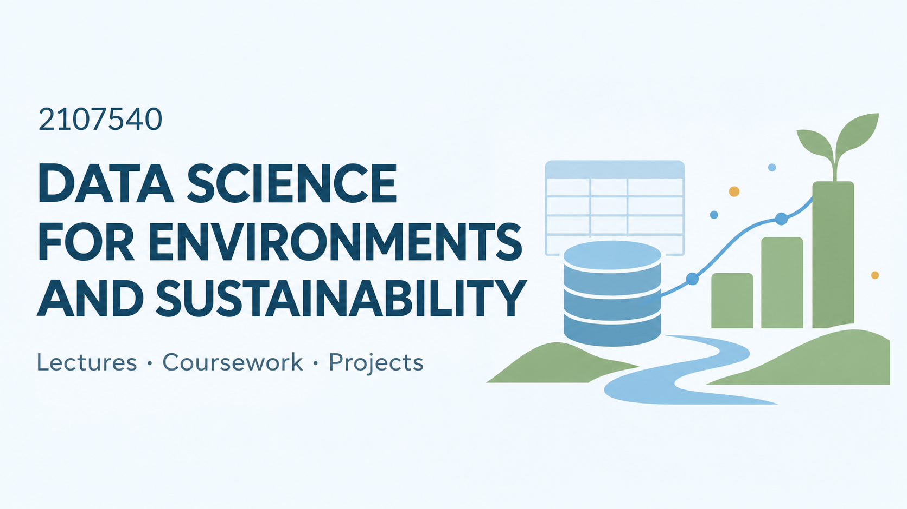

# 2107540 Data Science for Environment and Sustainability



Section 1, Semester 2026/1
Instructor: Department of Environmental Engineering, Chulalongkorn University

## Syllabus

**Course description:** Fundamental concepts of data science and its applications in environmental engineering and sustainability. This course covers data acquisition, exploration, cleaning, visualization, and analysis techniques using both Excel and Python.

**Learning objectives:** By the end of the course, students will be able to:
- Understand the fundamentals of data science and its applications in environmental sustainability
- Acquire, explore, and clean environmental datasets
- Perform statistical analysis and exploratory data analysis (EDA)
- Create effective data visualizations and interactive dashboards
- Implement data preparation and analysis using Python
- Apply SQL for database management and querying
- Analyze environmental datasets to support decision-making in sustainability

## Course Content

**Core Topics:**
- Introduction to Data Science
- Database Management (SQL)
- Data Acquisition & Exploration
- Exploratory Data Analysis (EDA) & Statistical Analysis
- Data Cleaning & Preprocessing
- Data Visualization & Dashboard Development
- Python for Data Science
- Introduction to Machine Learning for Environmental Applications

**Tools & Technologies:**
- Excel (Data Acquisition, EDA, Pivot Tables, Dashboards)
- SQL & SQLite
- Python (pandas, matplotlib, seaborn)
- Power BI (optional)

## Schedule

| Week | Lecture | Topic | Materials |
|------|---------|-------|-----------|
| 1 | Lecture 1 | Introduction to Data Science | [Lecture 1](https://github.com/Chatrphol-Chula-Coursework/2107540_Data_Science_for_Environment_and_Sustainability/tree/main/Lecture%201%20Intro%20Data%20Science) |
| 2 | Lecture 2 | Database Management | [Lecture 2](https://github.com/Chatrphol-Chula-Coursework/2107540_Data_Science_for_Environment_and_Sustainability/tree/main/Lecture%202%20Database) |
| 3 | Lecture 3 | SQL Database Commands | [Lecture 3](https://github.com/Chatrphol-Chula-Coursework/2107540_Data_Science_for_Environment_and_Sustainability/tree/main/Lecture%203%20SQL) |
| 4 | Lecture 4 | Data Acquisition & Exploration | [Lecture 4](https://github.com/Chatrphol-Chula-Coursework/2107540_Data_Science_for_Environment_and_Sustainability/tree/main/Lecture%204%20Excel%20Data%20Acquisition) |
| 5 | Lecture 5 | EDA & Statistical Analysis | [Lecture 5](https://github.com/Chatrphol-Chula-Coursework/2107540_Data_Science_for_Environment_and_Sustainability/tree/main/Lecture%205%20Excel%20EDA%20%26%20Stats%20Analysis) |
| 6 | Lecture 6 | Data Cleaning & Pivot Tables | [Lecture 6](https://github.com/Chatrphol-Chula-Coursework/2107540_Data_Science_for_Environment_and_Sustainability/tree/main/Lecture%206%20Excel%20Data%20Cleaning%20%26%20Pivot%20Table) |
| 7 | Lecture 7 | Data Visualization & Dashboards | [Lecture 7](https://github.com/Chatrphol-Chula-Coursework/2107540_Data_Science_for_Environment_and_Sustainability/tree/main/Lecture%207%20Excel%20Data%20Visualization%20%26%20Dashboard) |
| 8 | Lecture 8 | Data Preparation with Python | [Lecture 8](https://github.com/Chatrphol-Chula-Coursework/2107540_Data_Science_for_Environment_and_Sustainability/tree/main/Lecture%208%20Data%20Preparation%20with%20Python) |
| 9 | Lecture 9 | Data Visualization with Python | [Lecture 9](https://github.com/Chatrphol-Chula-Coursework/2107540_Data_Science_for_Environment_and_Sustainability/tree/main/Lecture%209%20Data%20Visualization%20with%20Python) |
| 10 | Lecture 10 | Introduction to ML for Data Science | [Lecture 10](https://github.com/Chatrphol-Chula-Coursework/2107540_Data_Science_for_Environment_and_Sustainability/tree/main/Lecture%2010%20Intro%20ML%20for%20Data%20Science) |
| 11 | Lecture 11 | Introduction to Machine Learning II | [Lecture 11](https://github.com/Chatrphol-Chula-Coursework/2107540_Data_Science_for_Environment_and_Sustainability/tree/main/Lecture%2011%20Intro%20Machine%20Learning%20II) |

## Assignments & Projects

- **Lab Assignments:** 
  - [SQL Database Management (Lecture 3)](https://github.com/Chatrphol-Chula-Coursework/2107540_Data_Science_for_Environment_and_Sustainability/tree/main/Lecture%203%20SQL)
  
- **Quiz:** 
  - [2107540 Module Assessments](https://github.com/Chatrphol-Chula-Coursework/2107540_Data_Science_for_Environment_and_Sustainability/tree/main/Quiz%202107540)
  
- **Final Project:** 
  - [Data Science Environmental Sustainability Project](https://github.com/NuBFightForMyDream/2107540_DataSciEnvi_FinalProject)

## Course Structure

Each lecture includes:
- Presentation slides (PDF)
- Jupyter notebooks with code examples
- Datasets for hands-on practice
- Lab exercises for skill reinforcement

## Getting Started

1. Clone or download this repository:
   ```bash
   git clone https://github.com/Chatrphol-Chula-Coursework/2107540_Data_Science_for_Environment_and_Sustainability.git
   ```

2. Install required packages:
   ```bash
   pip install pandas matplotlib seaborn jupyter sqlite3
   ```

3. Navigate to individual lecture folders to access materials

4. Run Jupyter notebooks for interactive learning:
   ```bash
   jupyter notebook
   ```

## Prerequisites

- Basic programming knowledge (Python preferred but not required)
- Familiarity with Excel or similar spreadsheet software
- Understanding of basic statistics

## Repository Structure

```
2107540_Data_Science_for_Environment_and_Sustainability/
├── 2107540_Coverpage.jpg
├── README.md
├── Lecture 1 - Introduction to Data Science/
├── Lecture 2 - Database Management/
├── Lecture 3 - SQL Database Commands/
├── Lecture 4 - Data Acquisition & Exploration/
├── Lecture 5 - EDA & Statistical Analysis/
├── Lecture 6 - Data Cleaning & Pivot Tables/
├── Lecture 7 - Data Visualization & Dashboards/
├── Lecture 8 - Data Preparation with Python/
├── Lecture 9 - Data Visualization with Python/
├── Lecture 10 - Introduction to ML for Data Science/
├── Lecture 11 - Introduction to Machine Learning II/
├── 2107540 DataSciEnvi Final Project/
└── Quiz 2107540/
```

## Resources

- **Python Libraries:** pandas, numpy, matplotlib, seaborn, scikit-learn
- **Database:** SQLite3, SQL
- **Tools:** Jupyter Notebook, Excel, Power BI

## Contact & Support

For questions or issues, please refer to course materials or contact the Department of Environmental Engineering, Chulalongkorn University.

---

**Student ID:** 6730084521 Chatrphol Ovanonchai

🤖 Last updated: November 2026
